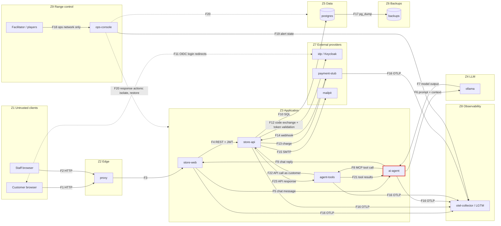

# Architecture

## Services

| Service          | Image / tech                         | Role                                                  | Est. RAM |
|------------------|--------------------------------------|-------------------------------------------------------|----------|
| `proxy`          | nginx                                | Single entry point on `127.0.0.1`; future WAF location | 20 MB    |
| `store-web`      | .NET 10 Blazor Web App               | Customer UI, staff UI, chat widget                    | 200 MB   |
| `store-api`      | .NET 10 ASP.NET Core Web API         | Auth, products, orders, invoices, shipping            | 200 MB   |
| `ai-agent`       | .NET 10 + Microsoft.Extensions.AI    | Customer chat agent; reaches data only via agent-tools | 150 MB   |
| `agent-tools`    | .NET 10 + ModelContextProtocol (MCP) | Tool server: the only path from the agent to any API; policy enforcement point ([ADR-0009](decisions/0009-agent-tool-server-mcp.md)) | 100 MB |
| `ollama`         | ollama/ollama                        | Local LLM inference (CPU)                             | 3–4 GB   |
| `postgres`       | postgres                             | Store database, seeded on first start                 | 150 MB   |
| `idp`            | Keycloak                             | Local OIDC provider posing as "Google" and "Meta"     | 600 MB   |
| `payment-stub`   | .NET 10 minimal API                  | Fake payment gateway + webhooks                       | 80 MB    |
| `mailpit`        | axllent/mailpit                      | Captures outbound email (password resets etc.)        | 30 MB    |
| `otel-collector` + `lgtm` | grafana/otel-lgtm           | Logs (Loki), traces (Tempo), metrics (Prometheus), Grafana | 1–1.5 GB |
| `cadvisor`       | cAdvisor                             | Per-container health/resource metrics                 | 80 MB    |
| `postgres-exporter` | prometheus-community              | Database health metrics                               | 30 MB    |
| `ops-console`    | .NET 10 Blazor (interactive server)  | Wargame: infra map, injects, decision log, response actions. **Not an attack target** ([ADR-0008](decisions/0008-wargame-and-ops-console.md)) | 200 MB |

**Budget:** ~6.6–8.1 GB of the 9.7 GB Docker allocation. The LLM is the dominant cost; see
[ADR-0004](decisions/0004-ai-agent-ollama.md).

`infra/topology.yaml` will be the single source of truth for services, networks and trust
boundaries. It drives the Ops Console map and the diagrams below.

## Data flow (draft: refine during threat modelling)

Boxes are **trust zones** (see `threat-model.md` §1.4). Every arrow that leaves a box crosses a
trust boundary. ai-agent is outlined in red: it sits in Z3 but is an untrusted actor (T8), so its
traffic with the rest of Z3 crosses boundary TB5. agent-tools is its only route to data, and its
calls to APIs (and the results coming back) cross TB11.
calls to APIs (and the results coming back) cross TB11.

### Flows

| ID | From → To | What crosses | Protocol |
|----|-----------|--------------|----------|
| F1 | Customer browser → proxy | Page requests, form posts, cookies | HTTP |
| F2 | Staff browser → proxy | Staff UI requests, cookies | HTTP |
| F3 | proxy → store-web | Forwarded requests (+ `X-Forwarded-*` headers) | HTTP |
| F4 | store-web → store-api | API calls with the user's JWT | HTTP/REST |
| F5 | store-web → ai-agent | Customer chat message + user identity | HTTP |
| F6 | ai-agent → ollama | System prompt, chat history, tool results | HTTP |
| F7 | ollama → ai-agent | Model output: text and tool-call requests | HTTP |
| F8 | ai-agent → agent-tools | Tool name + arguments chosen by the model, user identity | MCP (HTTP) |
| F9 | ai-agent → store-web | Chat reply rendered to the customer | HTTP |
| F10 | store-api → postgres | Queries and results | SQL/TCP |
| F11 | Browser ↔ idp | Login page, credentials, auth code redirect | HTTP redirects |
| F12 | store-api → idp | Auth code exchange, token/key validation | HTTP |
| F13 | store-api → payment-stub | Charge requests (card data or token) | HTTP |
| F14 | payment-stub → store-api | Payment result webhook | HTTP |
| F15 | store-api → mailpit | Emails (password resets, receipts) | SMTP |
| F16 | All app services → otel-collector | Logs, traces, metrics | OTLP |
| F17 | postgres → backups | Database dumps | pg_dump |
| F18 | Facilitator/players → ops-console | Wargame UI, decisions | HTTP |
| F19 | ops-console → LGTM | Alert state queries | HTTP |
| F20 | ops-console → range | Containment/recovery actions | Docker API / scripts |
| F21 | agent-tools → ai-agent | Tool results (may contain other users' text: notes, reviews, names) | MCP (HTTP) |
| F22 | agent-tools → store-api (later: any API) | API calls carrying the customer's token | HTTP/REST |
| F23 | store-api → agent-tools | API responses | HTTP/REST |

## Phases

| # | Phase | Status |
|---|-------|--------|
| 0 | Threat model & design | **In progress** |
| 1 | Skeleton: compose, Postgres schema + seed | |
| 2 | Telemetry stack + container health | |
| 3 | Store API + UI with local login | |
| 4 | Order lifecycle: cancel, invoices, payment stub, staff shipping | |
| 5 | OAuth via Keycloak ("Google"/"Meta") | |
| 6 | AI agent | |
| 7 | Arm the range: vulnerability catalogue + attack scripts | |
| 8 | Defence: detections, hardening, WAF, segmentation | |
| 9 | Wargame: Ops Console, scenarios, injects, role cards, after-action report | |

Groundwork for Phase 9 is laid earlier: audit events and trace IDs (Phases 2–3), backups and
restore scripts (Phase 1 onward), and `topology.yaml` (Phase 1).
