# Architecture

## Services

| Service          | Image / tech                         | Role                                                  | Est. RAM |
|------------------|--------------------------------------|-------------------------------------------------------|----------|
| `proxy`          | nginx                                | Single entry point on `127.0.0.1`; curated edge WAF (VULN-WAF-01) | 20 MB    |
| `store-web`      | .NET 10 Blazor Web App               | Customer UI, staff UI, chat widget                    | 200 MB   |
| `store-api`      | .NET 10 ASP.NET Core Web API         | Auth, products, orders, invoices, shipping            | 200 MB   |
| `ai-agent`       | .NET 10 + Microsoft.Extensions.AI    | Customer chat agent; reaches data only via agent-tools | 150 MB   |
| `agent-tools`    | .NET 10 + ModelContextProtocol (MCP) | Tool server: the only path from the agent to any API; policy enforcement point ([ADR-0009](decisions/0009-agent-tool-server-mcp.md)) | 100 MB |
| `ollama`         | ollama/ollama                        | Local LLM inference (CPU)                             | 3–4 GB   |
| `postgres`       | postgres                             | Store database, seeded on first start                 | 150 MB   |
| `idp`            | Keycloak                             | Local OIDC provider posing as "Google" and "Meta"     | 600 MB   |
| `payment-stub`   | .NET 10 minimal API                  | Fake payment gateway + webhooks                       | 80 MB    |
| `mailpit`        | axllent/mailpit                      | Captures outbound email (password resets etc.)        | 30 MB    |
| `otel-collector` | otel/opentelemetry-collector-contrib:0.162.0 | Single telemetry entry point: scrapes exporters, reads Docker log files (root, read-only), receives OTLP, tags everything with its trust zone | 100 MB |
| `lgtm`           | grafana/otel-lgtm:0.34.0             | Loki (logs), Prometheus (metrics), Tempo (traces), Grafana on 127.0.0.1:3000. **Anonymous Admin by default** (vulnerable) | 1–1.5 GB |
| `cadvisor`       | cadvisor:v0.60.6                     | Per-container CPU/memory/network. **Privileged**, read-only host mounts, no published port | 80 MB    |
| `postgres-exporter` | postgres-exporter:v0.20.1         | Database health metrics via the `metrics_reader` role (`pg_monitor`) | 30 MB    |
| `backup`         | postgres:18 (`pg_dump`)              | Scheduled dumps of duckstore to the `pgbackups` volume (Z6); restore via `infra/backup/restore.sh` | 50 MB |
| `ops-console`    | .NET 10 Blazor (interactive server)  | Wargame: infra map, injects, decision log, response actions. **Not an attack target** ([ADR-0008](decisions/0008-wargame-and-ops-console.md)). Starts life as `range-control` in the alpha: the defence-toggle panel ([ADR-0011](decisions/0011-runtime-defence-toggles.md)) | 150–200 MB |

**Budget:** ~6.6–8.1 GB of the 9.7 GB Docker allocation. The LLM is the dominant cost; see
[ADR-0004](decisions/0004-ai-agent-ollama.md).

`infra/topology.yaml` will be the single source of truth for services, networks and trust
boundaries. It drives the Ops Console map and the diagrams below.

### Network segmentation (Phase 8d)

The trust zones above are enforced at the Docker-network layer: the one flat `range` net is split
into tiers, and a service can reach another only when they share a network. Membership:

| Network | internal | Members |
|---------|:---:|---------|
| `edge`  | | proxy, store-web — the DMZ; only the proxy publishes a host port |
| `svc`   | | store-web, store-api, agent-tools, idp, payment-stub, otel-collector |
| `agent` | | store-web, ai-agent, ollama, agent-tools, otel-collector — the agent sandbox (TB5) |
| `data`  | ✓ | store-api, postgres, backup, postgres-exporter — no route off the host |
| `obs`   | | otel-collector, lgtm, cadvisor, postgres-exporter |
| `ops`   | | range-control, postgres, otel-collector — the isolated control plane (ADR-0011) |

Blocks this enforces (verified container-to-container): the edge proxy cannot reach the data tier;
**ai-agent and ollama cannot reach store-api or Postgres directly** — the agent's only route to any
API is agent-tools (ADR-0009, TB5/TB11); idp and payment-stub cannot reach Postgres; and Grafana
(`lgtm`) cannot reach the app or data tiers. store-web is the trusted front controller spanning
`edge`/`svc`/`agent`; otel-collector is the telemetry hub spanning every tier that emits.

## Data flow (draft: refine during threat modelling)

Boxes are **trust zones** (see `threat-model.md` §1.4). Every arrow that leaves a box crosses a
trust boundary. Inside Z3 there are two sub-zones:
- **Z3a Agent (untrusted)**, outlined in red: ai-agent is an untrusted actor (T8). Anything crossing
  this box's edge (F5, F8, F9, F21) crosses **TB5**.
- **Z3b Tool gateway**: agent-tools, the agent's only route to data. Its calls to APIs and the
  responses (F22, F23) cross **TB11**.

F16 (telemetry) is drawn as one arrow from the whole Application zone to keep the diagram readable;
every app service sends OTLP.

*Source: [diagrams/data-flow.mmd](diagrams/data-flow.mmd). After editing it, run `npm run diagrams` (needs Node and Chrome or Edge) and commit both files.*

### Flows

| ID | From → To | What crosses | Protocol |
|----|-----------|--------------|----------|
| F1 | Customer browser → proxy | Page requests, form posts, cookies | HTTP |
| F2 | Staff browser → proxy | Staff UI requests, cookies | HTTP |
| F3 | proxy → store-web | Forwarded requests (+ `X-Forwarded-*` headers) | HTTP |
| F4 | store-web → store-api | API calls with the user's JWT | HTTP/REST |
| F5 | store-web → ai-agent | Customer chat message + user identity | HTTP |
| F6 | ai-agent → ollama | System prompt, chat history, tool results | HTTP |
| F7 | ollama → ai-agent | Model output: text and tool-call requests | HTTP |
| F8 | ai-agent → agent-tools | Tool name + arguments chosen by the model, user identity | MCP (HTTP) |
| F9 | ai-agent → store-web | Chat reply rendered to the customer | HTTP |
| F10 | store-api → postgres | Queries and results | SQL/TCP |
| F11 | Browser ↔ idp | Login page, credentials, auth code redirect | HTTP redirects |
| F12 | store-api → idp | Auth code exchange, token/key validation | HTTP |
| F13 | store-api → payment-stub | Charge requests (card data or token) | HTTP |
| F14 | payment-stub → store-api | Payment result webhook | HTTP |
| F15 | store-api → mailpit | Emails (password resets, receipts) | SMTP |
| F16 | All app services → otel-collector | Logs, traces, metrics | OTLP |
| F17 | postgres → backups | Database dumps | pg_dump |
| F18 | Facilitator/players → ops-console | Wargame UI, decisions | HTTP |
| F19 | ops-console → LGTM | Alert state queries | HTTP |
| F20 | ops-console → range | Containment/recovery actions | Docker API / scripts |
| F21 | agent-tools → ai-agent | Tool results (may contain other users' text: notes, reviews, names) | MCP (HTTP) |
| F22 | agent-tools → store-api (later: any API) | API calls carrying the customer's token | HTTP/REST |
| F23 | store-api → agent-tools | API responses | HTTP/REST |
| F24 | postgres-exporter → postgres | Database statistics (`metrics_reader`) | SQL/TCP |
| F25 | otel-collector → lgtm | All telemetry | OTLP |

## Phases

| # | Phase | Alpha | Status |
|---|-------|-------|--------|
| 0 | Threat model & design | ✓ | Core done; continues alongside the build |
| 1 | Skeleton: compose, Postgres schema + seed | ✓ | Done |
| 2 | Telemetry stack + container health | ✓ | Done: "Range health" dashboard |
| 3 | Store API + UI with local login | ✓ | Done: 9 toggles (PWD, AUTH, IDOR, SQLI, INFO, MASS, XSS, CSRF, SESSION); DBROLE deferred to Phase 4 |
| 4 | Order lifecycle + range-control panel | ✓ (minimal) | Done: panel, place/cancel/pay/ship, DBROLE (restart) & AUTHZ toggles |
| 5 | OAuth via Keycloak ("Google"/"Meta") | ✓ | Done: social login, VULN-OAUTH-01/02/03 |
| 6 | AI agent + agent-tools, swappable LLM (ADR-0010) | ✓ | Done: chat UI; VULN-LLM-02/05/06 wired |
| 7 | Arm the range: vulnerability catalogue + attack scripts | | **In progress**: catalogue ([docs/vulnerabilities.md](vulnerabilities.md)); vertical slice IDOR/SQLI/AUTHZ/LLM-06 with confirm probes + detections |
| 8 | Defence: detections, hardening, WAF, segmentation | | **Done**: 8a (6 provisioned Grafana alerts + log card-number redaction), 8b (CSP/security-headers toggle VULN-HEADERS-01; Grafana anonymous-Admin infra toggle VULN-GRAFANA-01), 8c (nginx edge proxy Z2 + curated WAF toggle VULN-WAF-01, owns the published port), 8d (flat `range` net split into `edge`/`svc`/`agent`/`data`(internal)/`obs`/`ops` tiers — blocks verified) |
| 9 | Wargame: Ops Console, scenarios, injects, role cards, after-action report | ✓ (basics) | Ops Console in range-control: map, injects, decision log, after-action report ([ADR-0008](decisions/0008-wargame-and-ops-console.md)) |

**Alpha:** a store you can log into and order from, with telemetry and the AI agent. The alpha is
naturally unhardened; vulnerability toggles (ADR-0006) arrive in Phase 7.

Groundwork for Phase 9 is laid earlier: audit events and trace IDs (Phases 2–3), backups and
restore scripts (Phase 1 onward), and `topology.yaml` (Phase 1).
