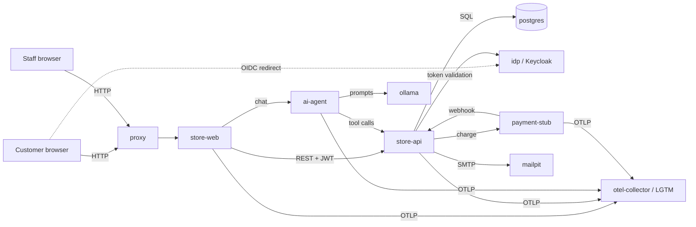

# Architecture

## Services

| Service          | Image / tech                         | Role                                                  | Est. RAM |
|------------------|--------------------------------------|-------------------------------------------------------|----------|
| `proxy`          | nginx                                | Single entry point on `127.0.0.1`; future WAF location | 20 MB    |
| `store-web`      | .NET 10 Blazor Web App               | Customer UI, staff UI, chat widget                    | 200 MB   |
| `store-api`      | .NET 10 ASP.NET Core Web API         | Auth, products, orders, invoices, shipping            | 200 MB   |
| `ai-agent`       | .NET 10 + Microsoft.Extensions.AI    | Customer chat agent with order-lookup tools           | 150 MB   |
| `ollama`         | ollama/ollama                        | Local LLM inference (CPU)                             | 3–4 GB   |
| `postgres`       | postgres                             | Store database, seeded on first start                 | 150 MB   |
| `idp`            | Keycloak                             | Local OIDC provider posing as "Google" and "Meta"     | 600 MB   |
| `payment-stub`   | .NET 10 minimal API                  | Fake payment gateway + webhooks                       | 80 MB    |
| `mailpit`        | axllent/mailpit                      | Captures outbound email (password resets etc.)        | 30 MB    |
| `otel-collector` + `lgtm` | grafana/otel-lgtm           | Logs (Loki), traces (Tempo), metrics (Prometheus), Grafana | 1–1.5 GB |
| `cadvisor`       | cAdvisor                             | Per-container health/resource metrics                 | 80 MB    |
| `postgres-exporter` | prometheus-community              | Database health metrics                               | 30 MB    |

**Budget:** ~6–7.5 GB of the 9.7 GB Docker allocation. The LLM is the dominant cost; see
[ADR-0004](decisions/0004-ai-agent-ollama.md).

## Data flow (draft: refine during threat modelling)

## Phases

| # | Phase | Status |
|---|-------|--------|
| 0 | Threat model & design | **In progress** |
| 1 | Skeleton: compose, Postgres schema + seed | |
| 2 | Telemetry stack + container health | |
| 3 | Store API + UI with local login | |
| 4 | Order lifecycle: cancel, invoices, payment stub, staff shipping | |
| 5 | OAuth via Keycloak ("Google"/"Meta") | |
| 6 | AI agent | |
| 7 | Arm the range: vulnerability catalogue + attack scripts | |
| 8 | Defence: detections, hardening, WAF, segmentation | |
